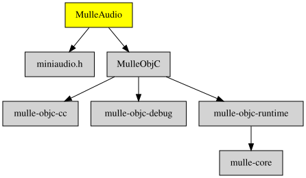

# MulleAudio

#### 🦻 MulleAudio plays sounds (like a soundboard)

MulleAudio allows you to load audio from files or embedded data and play
it. MulleAudio can mix multiple voice that are being played simultaneously.

MulleAudio is conceptually based on [Finch](https://github.com/zoul/Finch),
but uses [miniaudio](https://miniaud.io/) and [mulle-objc](https://mulle-objc.github.io)

> #### TODO
>
> Investigate to use [soloud](https://solhsa.com/soloud/) which is on top
> of miniaudio for more features ?
>


| Release Version                                       | Release Notes  | AI Documentation
|-------------------------------------------------------|----------------|---------------
|  [](//github.com/MulleUI/MulleAudio/actions) | [RELEASENOTES](RELEASENOTES.md) | [DeepWiki for MulleAudio](https://deepwiki.com/MulleUI/MulleAudio)


## Example

``` objc
#import "MulleAudio.h"


int  main( int argc, char *argv[])
{
   MulleAudioContext  *context;
   MulleAudioEngine   *engine;
   MulleAudioSound    *sound;
   char               *filename;

   filename = argc == 2 ? argv[ 1] : "ImperialMarch60.wav";

   context = [MulleAudioContext instance];
   engine  = [context defaultAudioEngine];
   if( ! engine)
   {
      mulle_fprintf( stderr, "Could not create a playback engine\n");
      return( 1);
   }

   sound = [engine audioSoundWithContentsOfFileUTF8String:filename];
   if( ! sound)
   {
      mulle_fprintf( stderr, "Could not load \"%s\"\n", filename);
      return( 1);
   }

   [sound setFadeIn:10.0
        startVolume:0.0
          endVolume:0.8];
   [sound setBalance:-1.0];
   [sound setPitch:0.75];

   mulle_fprintf( stderr, "Playing \"%s\" on %@\n", filename,
                                                    [engine audioDevice]);

   [sound start];
   [sound waitForCompletion];

   // MEMO: as the miniaudio thread has been turned into a NSThread,
   //       when doing a pedantic exit, the universe will wait for
   //       it to finish. But it won't, unless we uninit miniaudio
   [context mullePerformFinalize];
   return( 0);
}
```


### You are here




## Add

Use [mulle-sde](//github.com/mulle-sde) to add MulleAudio to your project:

``` sh
mulle-sde add github:MulleUI/MulleAudio
```

To only add the sources of MulleAudio with dependency
sources use [clib](https://github.com/clibs/clib):


``` sh
clib install --out src/MulleUI MulleUI/MulleAudio
```

Add `-isystem src/MulleUI` to your `CFLAGS` and compile all the sources that were downloaded with your project.


## Install

Use [mulle-sde](//github.com/mulle-sde) to build and install MulleAudio and all dependencies:

``` sh
mulle-sde install --prefix /usr/local \
   https://github.com/MulleUI/MulleAudio/archive/latest.tar.gz
```

### Legacy Installation

Install the requirements:

| Requirements                                 | Description
|----------------------------------------------|-----------------------
| [MulleObjC](https://github.com/mulle-objc/MulleObjC)             | 💎 A collection of Objective-C root classes for mulle-objc
| [mulle-objc-list](https://github.com/mulle-objc/mulle-objc-list)             | 📒 Lists mulle-objc runtime information contained in executables.

Download the latest [tar](https://github.com/MulleUI/MulleAudio/archive/refs/tags/latest.tar.gz) or [zip](https://github.com/MulleUI/MulleAudio/archive/refs/tags/latest.zip) archive and unpack it.

Install **MulleAudio** into `/usr/local` with [cmake](https://cmake.org):

``` sh
PREFIX_DIR="/usr/local"
cmake -B build                               \
      -DMULLE_SDK_PATH="${PREFIX_DIR}"       \
      -DCMAKE_INSTALL_PREFIX="${PREFIX_DIR}" \
      -DCMAKE_PREFIX_PATH="${PREFIX_DIR}"    \
      -DCMAKE_BUILD_TYPE=Release &&
cmake --build build --config Release &&
cmake --install build --config Release
```


## Author

[Nat!](https://mulle-kybernetik.com/weblog) for Mulle kybernetiK  


